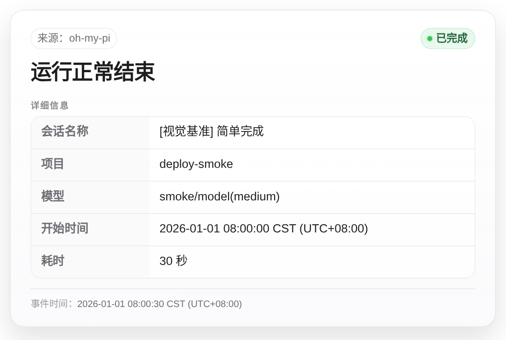
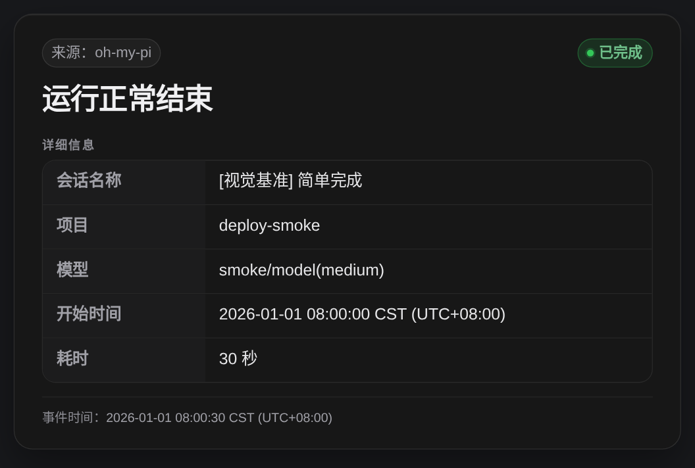
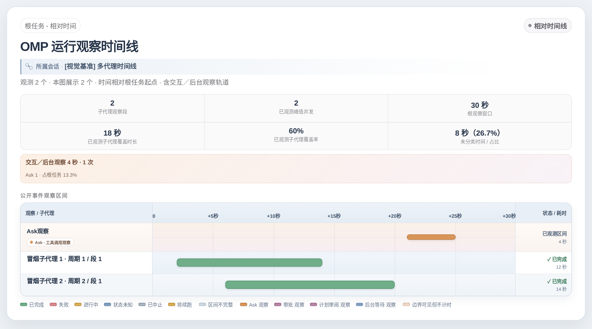

# AstrBot Webhook Notifier

AstrBot Webhook 通知插件：将 Oh My Pi（OMP）、OpenCode 的任务完成／待处理事件及通用 Markdown 消息，以文本或 HTML 卡片推送到 QQ 私聊或普通 QQ 群。

[](https://github.com/AsterleedsGuild0/astrbot_plugin_webhook_notifier/releases) [](LICENSE) [](pyproject.toml) [](https://docs.astrbot.app/)

支持 `aiocqhttp` 与 QQ 官方 WebSocket；文本模式无需图片渲染服务，HTML 卡片依赖 AstrBot `html_render` / T2I。

> 推荐使用 QQ 官方 Bot  WebSocket 接入私聊对话：可以直接扫码接入 AstrBot，而且 QQ 官方 Bot 限制了只能和自己私聊，相对不容易被风控。

>**[快速开始](#快速开始) · [支持范围](#支持范围) · [提交问题](https://github.com/AsterleedsGuild0/astrbot_plugin_webhook_notifier/issues)**

## 效果图

<p> </p>

<details>
<summary>展开查看多代理与等待时间线</summary>



</details>

以上为合成数据的实际渲染基准图，不含真实会话或凭据。Release ZIP 不含视觉测试图片，可在[仓库首页](https://github.com/AsterleedsGuild0/astrbot_plugin_webhook_notifier#效果图)查看。

---

## 能做什么

| 场景 | 用法 |
| --- | --- |
| Coding Agent 通知 | OMP 运行收束时区分正常、失败、中止和未知，并提醒待处理交互；OpenCode 支持完成、失败、权限与问题通知 |
| 通用 Markdown 推送 | 从脚本或服务发送构建结果、运维摘要等受限 Markdown 消息 |

- 不必一直盯着终端，在 QQ 中查看结果或等待处理的事项。
- 按 Endpoint 绑定推送目标，Token 可独立轮换、撤销，不允许调用方任意指定收件人。
- 过滤短时成功任务与成功子任务通知，减少打扰；失败和待处理事件不按时长过滤。
- OMP 卡片可选浅色／深色主题；HTML 图片链路异常时自动降级为文本。
- 在认证后的 Plugin Page 复制、编辑、预览、保存、应用或删除自定义 HTML 模板。

---

## 快速开始

### 1. 安装

需要已运行的 AstrBot、上述受支持平台及 Python >= 3.10。依赖见 [pyproject.toml](pyproject.toml)。

| 方式 | 操作 |
| --- | --- |
| Release ZIP（推荐） | 从 [最新 Release](https://github.com/AsterleedsGuild0/astrbot_plugin_webhook_notifier/releases/latest) 下载插件 ZIP，在 WebUI 选择“从文件安装” |
| WebUI 仓库 URL | 在 URL 安装入口填写 `https://github.com/AsterleedsGuild0/astrbot_plugin_webhook_notifier` |
| 源码安装 | 执行下方命令，将插件放入 `AstrBot/data/plugins` |

```bash
git clone https://github.com/AsterleedsGuild0/astrbot_plugin_webhook_notifier.git \
  AstrBot/data/plugins/astrbot_plugin_webhook_notifier
```

安装后在 WebUI 加载或重载插件，确认插件列表显示已加载。升级前查看[公共契约](docs/public-contract.md)与[发布说明](https://github.com/AsterleedsGuild0/astrbot_plugin_webhook_notifier/blob/main/CHANGELOG.md)。

### 2. 最小配置与 Endpoint

- 进入 **AstrBot WebUI → 插件管理 → Webhook Notifier → 配置**，保持 `enabled: true`、`render_mode: text`。
- `server` 默认监听 `127.0.0.1:18080`，`base_path` 为 `/webhook`。按部署方式设置 `host`、`port` 与含 base path 的 `public_base_url`；同机可直连，跨主机或公网建议 HTTPS 反向代理。步骤见[端到端部署](docs/end-to-end-setup.md)。
- 私聊主动通知默认关闭。首次可保留此安全默认值验证 `skipped`；确认平台规则和风险后，才设 `enable_private_notifications: true` 并重载，以验证实际送达。

在与 Bot 的私聊中执行（`<唤醒词>` 默认是 `/`）：

```text
<唤醒词>whn token new private demo
```

省略 `--provider` 时创建 `markdown` Endpoint。成功后聊天返回 `Endpoint Path`，Token 通过独立消息交付；Base URL 从认证后的 **Plugin Page** 复制，三者分别保存。Coding Agent 使用下一节的专用 Endpoint。

---

### 3. 发送第一条消息

将以下占位值替换为自己的配置；Token 只放 Header，不拼入 URL：

```bash
export WHN_BASE_URL='https://example.invalid/webhook'
export WHN_ENDPOINT_PATH='<endpoint-path>'
export WHN_TOKEN='<token>'
curl --fail-with-body --silent --show-error \
  -X POST "${WHN_BASE_URL}/${WHN_ENDPOINT_PATH}" \
  -H 'Content-Type: application/json' \
  -H "Authorization: Bearer ${WHN_TOKEN}" \
  --data-binary @- <<'JSON'
{"event":"markdown.message","id":"readme-demo-1","title":"Webhook 通知","markdown":"## 接入完成\n\n这是一条 **Markdown** 通知。"}
JSON
```

预期：私聊开关开启时返回 HTTP 200、`code: 0`、`message: "ok"`，Bot 私聊收到通知；默认关闭时返回 HTTP 200、`message: "skipped"`，不投递、不应重试。每条新消息使用不同 `id`，同一消息重试保持 `id` 不变。异常见 [FAQ](#faq)。

---

## 接入 Coding Agent

先升级并重载 AstrBot 服务端，再更新客户端；旧服务端可能拒绝新客户端字段。

### Oh My Pi（OMP）

1. 在 Bot 私聊执行 `<唤醒词>whn token new private my-omp --provider omp`；要深色卡片可追加 `--theme dark`。
2. 在 OMP 依次执行 `/marketplace add AsterleedsGuild0/astrbot_plugin_webhook_notifier`、`/marketplace install omp-webhook-notifier@astrbot-webhook-notifier`。
3. 在启动 OMP 的环境中分别设置 `OMP_SESSION_WEBHOOK_URL`（Base URL 与 Endpoint Path 组合）和 `OMP_SESSION_WEBHOOK_TOKEN`，然后重启 OMP。
4. 在允许通知的目标上运行超过默认 15 秒阈值的任务，确认收到结果。整包手动安装、旧 Hook 迁移、历史环境变量和排障见[客户端接入](docs/client-integration.md)；服务端设置见[端到端部署](docs/end-to-end-setup.md)。

### OpenCode

1. 在 Bot 私聊执行 `<唤醒词>whn token new private my-opencode --provider opencode`，分别保存 Base URL、Endpoint Path 与 Token。
2. 将 [`webhook-notifier.ts`](integrations/opencode/webhook-notifier.ts) 放到 OpenCode 所在机器，合并 [`opencode.jsonc`](integrations/opencode/opencode.jsonc) 的 `plugin` tuple，用 `{env:...}` 或 `{file:...}` 分别提供 URL 与 Token。
3. 完全重启 OpenCode Desktop 或 CLI，触发完成、失败和权限请求，核对目标通知。默认 `actionContentMode: strict` 只发送交互类别／计数；内容模式、实例名、时间线、版本前提及排障见 [OpenCode 集成](docs/opencode-integration.md)。

---

## 支持范围

以下为已有验证范围，不表示允许无限制主动发送；其他 adapter 未验证，不承诺支持。

| 平台 / 场景 | 状态 | 当前边界 |
| --- | --- | --- |
| `aiocqhttp` | 已验证 | 命令、普通 QQ 群通知与 HTML 图片卡片 |
| `qq_official` WebSocket 私聊**(🌟推荐🌟)** | 已验证 | 私聊命令、Webhook 鉴权、主动通知与 OMP 图片卡片 |
| `qq_official` WebSocket 普通 QQ 群 | 已验证 | 群验证、主动 Webhook 与 OMP HTML 图片卡片 |
| `qq_official` WebSocket QQ 频道（Guild） | 无支持计划 | 当前身份与群验证流程不覆盖 QQ 频道 |
| `qq_official_webhook` | 无支持计划 | 与 `qq_official` WebSocket 是不同接入方式，插件未声明、未适配 |

私聊开关不影响群通知；主动消息规则与多 Bot 边界见[平台投递策略](docs/platform-delivery-policy.md)。

---

## 常用命令

除帮助外，下表命令均在私聊执行，仅管理当前平台中自己的 Endpoint；群申请还需群主／管理员验证。完整流程和管理员命令见[命令参考](docs/command-reference.md)。

| 场景 | 命令 |
| --- | --- |
| 查看帮助 | `<唤醒词>whn help` |
| 创建私聊 Endpoint | `<唤醒词>whn token new private [名称]` |
| 申请群聊 Endpoint | `aiocqhttp: <唤醒词>whn token new group <数字群号> [名称]`；`qq_official: <唤醒词>whn token new group current [名称]` |
| 查看自己的 Endpoint | `<唤醒词>whn token list` |
| 轮换 Token | `<唤醒词>whn token rotate <名称>` |
| 切换 OMP 卡片主题 | `<唤醒词>whn token theme <名称> <light或dark>` |
| 撤销 Endpoint | `<唤醒词>whn token revoke <名称>` |
| 永久删除终态 Endpoint | `<唤醒词>whn token delete <名称>` |

---

## 配置摘要

| 配置 | 默认值 | 作用 |
| --- | --- | --- |
| `enabled` | `true` | 启用插件；创建可投递 Endpoint 后自动启动 HTTP 服务 |
| `render_mode` | `text` | 选择 `text` 或 `html_image`，使用纯文本或 HTML 图片 |
| `notification_mode` | `focused` | 仅抑制成功完成的子代理／辅助会话；`all` 发送全部通知 |
| `min_completion_duration_seconds` | `15` | 可靠耗时低于阈值的成功任务不通知；`0` 关闭过滤 |
| `enable_private_notifications` | `false` | 是否允许 Webhook 主动投递到私聊目标 |
| `fallback_to_text` | `true` | HTML 图片链路失败时降级为文本 |
| `server` | 本地监听 | 配置监听地址、端口、base path、公开 Base URL 与请求体上限 |

以上均有默认值；外部接入须按网络环境调整 `server`。全量配置以 [`_conf_schema.json`](_conf_schema.json) 为准；HTML 模板与 Plugin Page 操作见[模板变量](docs/template-variables.md)。

---

## 安全提示

- 公网入口使用 HTTPS，优先由反向代理转发到本地监听；URL 与 Token 分开保存，泄露后立即 `token rotate`。
- 开启私聊前核对 QQ 官方主动消息规则或 OneBot 风控边界；Token 只授权 Endpoint 已绑定的目标，不能传入任意收件人。
- OMP 名称和默认待处理摘要仍可能含业务信息；OpenCode 的 `summary`／`full` 模式可能外发业务文本或目标路径，启用前评估。
- `html_image` 模式会把通知内容（含会话名与待处理摘要）发给 AstrBot 配置的 T2I 服务渲染；使用非自建 T2I 时内容会离开本机，隐私敏感场景改用 `text` 或自建 T2I。
- Markdown 不执行原始 HTML、模板语法或外部资源，仅允许普通 HTTP(S) 链接；自定义 HTML 模板需另行审查。
- 公开 Issue、日志和截图须清理凭据、完整 Webhook URL、Endpoint Path、账号、群标识、消息正文及部署拓扑。更换平台实例标识须按 [rebind runbook](docs/platform-id-rebind-runbook.md) 操作，不直接编辑数据文件。

字段白名单、匿名关联、投递与重试边界见[安全与运维](docs/security-and-operations.md)。

---

## 文档索引

- 使用与配置：[命令参考](docs/command-reference.md) · [端到端部署](docs/end-to-end-setup.md) · [配置 schema](_conf_schema.json) · [HTML 模板](docs/template-variables.md)
- 客户端：[OMP 接入](docs/client-integration.md) · [OpenCode 接入](docs/opencode-integration.md)
- 安全与迁移：[安全与运维](docs/security-and-operations.md) · [平台投递策略](docs/platform-delivery-policy.md) · [公共契约与升级兼容](docs/public-contract.md) · [平台 ID rebind](docs/platform-id-rebind-runbook.md)
- 开发与发布：[发布流程](docs/release.md) · [CHANGELOG](https://github.com/AsterleedsGuild0/astrbot_plugin_webhook_notifier/blob/main/CHANGELOG.md) · [PRD](docs/PRD.md) · [FSD](docs/FSD.md)

---

## FAQ

- **Endpoint 创建成功却没通知？** 先检查私聊开关与响应的 `message` / `skip_reason`；成功短任务、成功子任务和重复请求也可能被跳过，规则见[安全与运维](docs/security-and-operations.md)。
- **HTML 图片失败怎么办？** 保持 `fallback_to_text: true`，检查响应中的 `fallback_reason`、AstrBot `html_render` / T2I 服务和模板；见[渲染排障](docs/t2i-rendering-notes.md)。
- **选错 Provider 能只轮换 Token 吗？** 不能。Provider 创建后不可变，须新建正确类型的 Endpoint 并更新调用方 URL／Token；旧默认值迁移见[公共契约](docs/public-contract.md)。

---

## 反馈与 License

缺陷、使用问题与贡献建议请提交 [GitHub Issue](https://github.com/AsterleedsGuild0/astrbot_plugin_webhook_notifier/issues)，附脱敏后的复现步骤与版本。本项目采用 [MIT License](LICENSE)。

---
